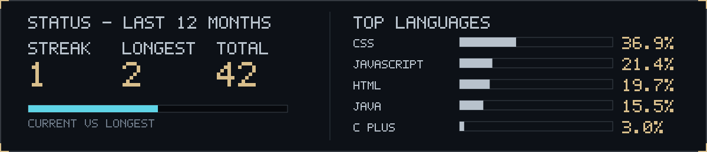
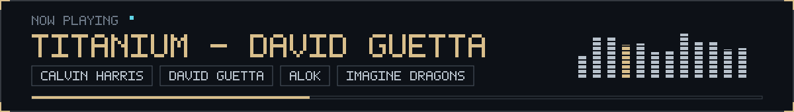

  

 

  

  

    Software developer focused on <b>Java</b> and web development, expanding into full-stack with React and Node.js. 
    I build innovative, ethical technology, and I shape concepts and visual experiences in Blender and the Adobe Creative Suite, 
    with a weakness for automotive design. Bilingual, with international and multicultural project experience. 
    In my free time: gaming, new tech trends and open source.
  

  <table>
    <tr>
      <td align="center"><b>Java &amp; Web</b></td>
      <td align="center"><b>Full-stack</b></td>
      <td align="center"><b>Ethical tech</b></td>
      <td align="center"><b>3D &amp; Design</b></td>
    </tr>
  </table>

 

  

  
<b>CODE</b>

  
  
  
  
  
  
  
  
  

  
<b>CREATE</b>

  
  
  
  

 

  

  <table>
    <tr>
      <td align="center" width="33%"><b>PLACEHOLDER</b> Featured project slot 1</td>
      <td align="center" width="33%"><b>PLACEHOLDER</b> Featured project slot 2</td>
      <td align="center" width="33%"><b>PLACEHOLDER</b> Featured project slot 3</td>
    </tr>
  </table>

 

  
  
  

 

  
  

 

  

  

    
  

